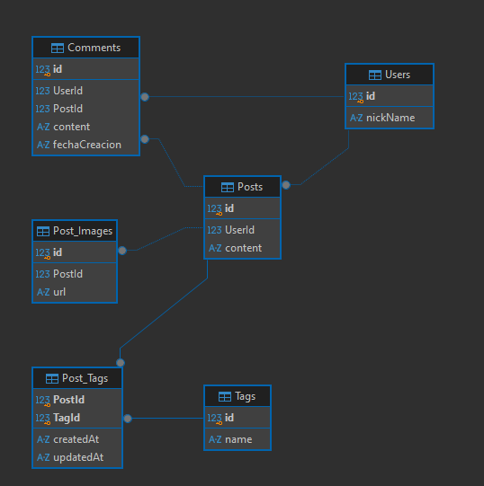

# UnaHur Anti-Social Net


El proyecto tiene como objetivo desarrollar el backend de UnaHur Anti-Social Net, mediante una API REST que permita gestionar usuarios, publicaciones, imágenes, comentarios y etiquetas, garantizando la integridad de los datos. 

## Diagrama Entidad - Relacion



### Relaciones principales

- **`User` → `Post`:** un usuario puede crear muchas publicaciones; cada publicación tiene un usuario autor.
- **`User` → `Comment`:** un usuario puede crear muchos comentarios; cada comentario tiene un usuario autor.
- **`Post` → `Comment`:** una publicación puede recibir muchos comentarios; cada comentario corresponde a una publicación.
- **`Post` → `Post_Images`:** una publicación puede tener varias imágenes; cada imagen pertenece a una publicación.
- **`Post` ↔ `Tag`:** relación muchos a muchos, mediante una tabla intermedia.

## Alcance funcional

El MVP contempla las siguientes funcionalidades:

- **Usuarios:** registrar usuarios identificados por un `nickName` único.
- **Publicaciones:** un usuario registrado puede crear una publicación con una descripción obligatoria y una fecha asociada. Una publicación puede tener cero, una o varias imágenes.
- **Imágenes:** en el alcance base se almacena la URL de cada imagen. Las imágenes pueden agregarse o quitarse después de crear la publicación.
- **Comentarios:** un usuario puede crear comentarios asociados a una publicación. Cada comentario debe identificar tanto a su autor como a la publicación a la que pertenece.
- **Etiquetas:** las publicaciones pueden tener etiquetas. Una misma etiqueta puede reutilizarse en varias publicaciones.
- **Antigüedad de los comentarios:** al consultar una publicación, no deben mostrarse los comentarios que superen la antigüedad máxima configurada en meses.

La visibilidad de un comentario por antigüedad **se calcula al consultar los datos**. No debe guardarse como una columna persistida en la base de datos: la consigna pide representarla mediante un atributo virtual de Sequelize. La cantidad de meses debe obtenerse de una variable de entorno, sin necesidad de modificar el código para cambiarla.

## Modelo de dominio

| Entidad | Responsabilidad | Datos y reglas principales |
|---|---|---|
| `User` | Representa a un usuario registrado. | `nickName` es único y no puede repetirse. |
| `Post` | Representa una publicación realizada por un usuario en una fecha determinada. | Tiene una descripción obligatoria y pertenece a un `User` autor. |
| `Post_Images` | Representa una imagen asociada a una publicación. | En el MVP alcanza con guardar la URL de la imagen. |
| `Comment` | Representa un comentario realizado por un usuario sobre una publicación en una fecha determinada. | Pertenece al `User` autor y al `Post` comentado. Su visibilidad temporal se calcula, no se persiste. |
| `Tag` | Representa una etiqueta que se puede asignar a publicaciones. | Una etiqueta puede estar asociada a muchas publicaciones y una publicación puede tener varias etiquetas. |

## Tecnologías

- Node.js
- Express
- Sequelize
- SQLite
- Joi
<!-- - Swagger -->

## Requisitos previos

Antes de iniciar, instalar:

- [Node.js](https://nodejs.org/en/download) 
- [Git](https://git-scm.com/) 

## Instalación y ejecución

1. Clonar el repositorio:

   ```bash
   git clone https://gitea.unahur.edu.ar/Estrategia-de-persistencia-C2-2026/ejercicio-47-grupo-6
   ```

2. Ingresar al directorio del proyecto:

   ```bash
   cd ejercicio-47-grupo-6
   ```

3. Instalar las dependencias:

   ```bash
   npm install
   ```

4. Iniciar el servidor con el script definido en `package.json` :

   ```bash
   npm run dev
   ```


## Variable de Entorno

La aplicación debe obtener el puerto, los datos de conexión y la antigüedad máxima de los comentarios desde variables de entorno. 

```env
PORT=3000
COMMENT_MAX_MESES=<cantidad_meses>
```

- `PORT`: puerto donde escucha Express.
- `COMMENT_MAX_MESES`: cantidad máxima de meses de antigüedad para mostrar comentarios.


## Endpoints

### 1. USUARIOS (User)

| Verbo | Recurso | Status code | Descripción |
|---|---|---|---|
| GET | `/users` | 200 | Obtener todos los usuarios. |
| GET | `/users/:id` | 200, 404 | Obtener un usuario en particular. |
| GET | `/users/:id/post` | 200, 404 | Obtener todas las publicaciones de un usuario. |
| GET | `/users/:id/comments` | 200, 404 | Obtener todos los comentarios de un usuario. |
| POST | `/users` | 201, 409 | Crear un usuario. |
| POST | `/users/:id/post` | 201, 404 | Crear una publicación realizada por un usuario. |
| POST | `/users/:id/comment` | 201, 404 | Crear un comentario realizado por un usuario. |
| PUT | `/users/:id` | 200, 404 | Modificar los datos de un usuario en particular. |
| DELETE | `/users/:id` | 200, 404 | Eliminar un usuario en particular. |

### 2. PUBLICACIONES (Post)

| Verbo | Recurso | Status code | Descripción |
|---|---|---|---|
| GET | `/post` | 200 | Obtener todas las publicaciones. |
| GET | `/post/:id` | 200, 404 | Obtener una publicación en particular. |
| GET | `/post/:id/images` | 200, 404 | Obtener todas las imágenes asociadas a una publicación. |
| GET | `/post/:id/comment` | 200, 404 | Obtener los comentarios visibles de una publicación en particular. |
| GET | `/post/:id/tag` | 200, 404 | Obtener todas las etiquetas asociadas a una publicación. |
| POST | `/post/:id/images` | 201, 404 | Agregar una imagen a una publicación mediante su URL. |
| POST | `/post/:id/tags/:tagId` | 201, 404 | Asociar una etiqueta existente a una publicación. |
| PUT | `/post/:id` | 200, 404 | Modificar los datos de una publicación. |
| DELETE | `/post/:id` | 200, 404 | Eliminar una publicación en particular. |
| DELETE | `/post/:id/images/:imgId` | 200, 404 | Quitar una imagen de una publicación en particular. |
| DELETE | `/post/:id/tag/:tagId` | 200, 404 | Desasociar una etiqueta de una publicación. |

### 4. COMENTARIOS (Comment)

| Verbo | Recurso | Status code | Descripción |
|---|---|---|---|
| GET | `/comment` | 200 | Obtener todos los comentarios. |
| PUT | `/comment/:id` | 200, 404 | Modificar los datos de un comentario en particular. |
| DELETE | `/comment/:id` | 200, 404 | Eliminar un comentario en particular. |

### 5. ETIQUETAS (Tag)

| Verbo | Recurso | Status code | Descripción |
|---|---|---|---|
| GET | `/tag` | 200 | Obtener todas las etiquetas. |
| GET | `/tag/:id` | 200, 404 | Obtener una etiqueta en particular. |
| POST | `/tag` | 201 | Crear una etiqueta. |
| PUT | `/tag/:id` | 200, 404 | Modificar los datos de una etiqueta en particular. |
| DELETE | `/tag/:id` | 200, 404, 409 | Eliminar una etiqueta en particular. |

## Estructura del proyecto

```text
.
├── assets/              # Imagenes del README
├── src/
│   ├── config/          # Configuración de entorno y base de datos
│   ├── models/          # Modelos Sequelize y asociaciones
│   ├── routes/          # Definición de rutas
│   ├── controllers/     # Recepción y respuesta de solicitudes HTTP
│   ├── middlewares/     # Validación Joi y manejo de errores
│   └── app.js           # Configuración de Express
├── .env.example         # Variable de entorno
├── package.json
├── package-lock.json
└── README.md
```